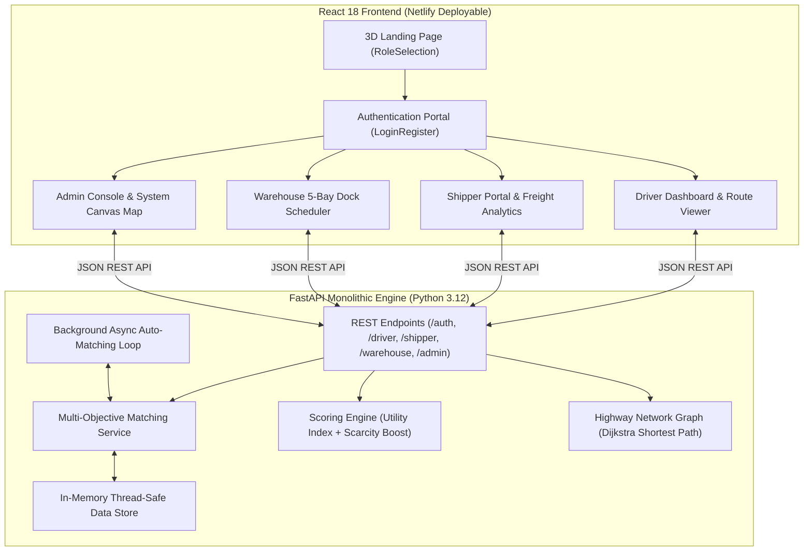

<div align="center">

# 🚛 FleetMind 10.0: Autonomous Fleet & Logistics Intelligence

[](https://fastapi.tiangolo.com)
[](https://react.dev)
[](https://tailwindcss.com)
[](https://www.docker.com)
[](https://www.netlify.com)
[](https://www.python.org)
[](https://opensource.org/licenses/MIT)

**Next-generation freight dispatch intelligence platform with real-time multi-objective matching, en-route intermediate pickup routing, 5-bay warehouse dock scheduling, and an interactive 3D spatial logistics network.**

[Key Features](#-key-features) • [3D Experience](#-3d-landing-page--stitch-aesthetic) • [Architecture](#-architecture) • [Quick Start](#-quick-start) • [Deployment](#-cloud-deployment) • [Test Accounts](#-demo-accounts)

---

</div>

## ✨ Key Features

- **Collaborative Multi-Agent Freight Network**: Dedicated workflows tailored for **Drivers**, **Shippers**, **Warehouse Managers**, and **Administrators**.
- **Algorithmic Load Matching**: Dynamic scoring heuristic balancing earnings margins, remaining vehicle payload capacity, detour distance, and market scarcity boost.
- **En-Route Intermediate Pickups**: Solves multi-load acceptance and route re-sequencing along active highway corridors to eliminate empty return trips.
- **5-Bay Dynamic Dock Scheduling**: Real-time terminal reservation matrix preventing warehouse bottlenecks.
- **Interactive 3D Spatial Logistics Canvas**: High-performance HTML5 Canvas rendering a rotating 3D logistics node constellation with real-time cargo shipment pulses and mouse parallax.
- **Zero-Dependency Vector Map**: Real-time canvas-rendered road network with live truck position interpolation.

---

## 🌐 3D Landing Page & "Stitch" Aesthetic

FleetMind 10.0 features a completely redesigned user onboarding interface:
- **3D Spatial Canvas**: Real-time rotating 3D distribution centers with depth projection and animated transit routes.
- **True 3D Physics Tilt Cards**: Cards calculate mouse position dynamically, applying perspective `rotateX` and `rotateY` transforms with specular radial-gradient reflections following the pointer.
- **"Stitch" Tech Accents**: Corner crosshair indicators (`+`), monospace agent identifiers (`AGENT.DRV`, `AGENT.SHP`, `AGENT.WHS`, `AGENT.ADM`), and live telemetry status monitors.
- **Quick Demo Drawer**: 1-click credential autofill for immediate testing.

---

## 🏗️ Architecture



### Algorithmic Scoring Formulation

The matching engine computes a comprehensive utility score ($0$ to $100$) for each eligible truck-load pair:

$$\text{Score} = 0.4 \times \text{Earnings Score} + 0.3 \times \text{Capacity Score} + 0.3 \times \text{Distance Score} + \text{Scarcity Boost}$$

Where:
- **Earnings Score**: Measures price margin above driver's preferred rate per kilometer.
- **Capacity Score**: Evaluates optimal payload weight utilization.
- **Distance Score**: Penalizes detours exceeding the maximum corridor detour threshold.
- **Scarcity Boost**: Dynamically increases urgency when competing candidate loads or eligible trucks are scarce.

---

## 🚀 Quick Start

### Prerequisites
- **Node.js** 18+ and **npm**
- **Python** 3.12+

### 1. Start the Backend
```bash
cd "Fleetmind 10.0 FINAL/backend"
python -m venv venv
venv\Scripts\activate       # On Linux/macOS: source venv/bin/activate
pip install -r requirements.txt
python scripts/generate_map.py
python test_data.py          # Seeds all demo trucks, loads & accounts
python -m app.main
```
Backend runs at: `http://localhost:8005` (Interactive Swagger at `/docs`).

### 2. Start the Frontend
```bash
cd "Fleetmind 10.0 FINAL/frontend"
npm install
npm start
```
Frontend runs at: `http://localhost:3000`.

---

## ☁️ Cloud Deployment

### Frontend on Netlify
- **Netlify Drop**: Drag and drop `Fleetmind 10.0 FINAL/frontend/build` directly into [app.netlify.com/drop](https://app.netlify.com/drop).
- **Git Continuous Deployment**: Configured via root [netlify.toml](netlify.toml) and `_redirects` for React Router SPA fallbacks.
- **Environment Variable**: Set `REACT_APP_API_URL` in Netlify Site Settings to your deployed backend domain.

### Backend on Render / Railway / Docker
- **Docker**:
  ```bash
  cd "Fleetmind 10.0 FINAL/backend"
  docker build -t fleetmind-backend .
  docker run -p 8005:8005 fleetmind-backend
  ```
- **Render Blueprint**: The repository includes [render.yaml](render.yaml) for 1-click cloud deployments binding dynamic `$PORT`.

---

## 👥 Demo Accounts

The project includes pre-seeded demo accounts (all passwords: **`1234`**):

| Role | Operator ID | Password | Access Capabilities |
| :--- | :--- | :--- | :--- |
| **Driver** | `dr1` | `1234` | View proposals, accept intermediate pickups, navigate waypoints, track payouts |
| **Shipper** | `sh1` | `1234` | Post loads, monitor transit status, view cost analytics |
| **Warehouse** | `wh1` | `1234` | 5-bay dock queue management, arrival scheduling, load release |
| **Admin** | `a1` | `1234` | Global vector map, system pair inspector, user accounts, audit telemetry |

---

## 📄 License

Distributed under the MIT License. See `LICENSE` for more information.
